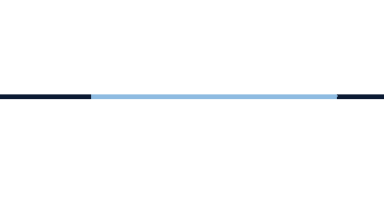

  

   
  

  
<strong>Computer Science Specialist student at the University of Toronto</strong> Building things for people

  
  
  

---

## About

Hi, I'm Eqraa. I'm a Computer Science Specialist student at the **University of Toronto**, focused on **Technology Leadership** and minoring in **Critical Studies in Equity and Solidarity**.

I like projects that bring people together or make a place feel safer and more accessible. I'm especially interested in community development, game design, and the human side of technology.

## What I'm up to

- **Events Coordinator** at [UDesign](https://www.linkedin.com/company/uoft-design/posts/?feedView=all)
- **Community Developer, Communications & Content Creator** at [New College's Office of Residence and Student Life](https://www.newcollege.utoronto.ca/student-experience/orsl/)

## Selected work

- **[Silent Signal](https://github.com/Eqraa-Khan/Silent-Signal)** - An anonymous student check-in platform about the barriers students face. I built most of the full-stack product and user flows. `Python` · `FastAPI` · `SQLite` · `JavaScript` · `Claude API`
- **[Board Game Recommender System](https://github.com/Eqraa-Khan/Board-Game-Recommender-System)** - A board game discovery project that uses scraped data to help people find their next game. `Python` · `Scrapy` · `Web scraping`
- **[Written Papers](https://github.com/Eqraa-Khan/Written-Papers)** - Essays and research on critical disability studies, colonial histories, South Asian families, and policy.
- **ClickTravel** - An AI travel planner that builds itineraries around a traveler's budget and preferences. I worked on the backend and Gemini API integration.

## Toolkit

  
  
  
  
  
  
  

## GitHub at a glance

  

  
<strong>More GitHub activity</strong>

   
  

    
  

## Recognition

**U of T International Merit Admission Award** (2025)

  

  Thanks for stopping by. Always happy to connect, collaborate, or talk about a good game.

